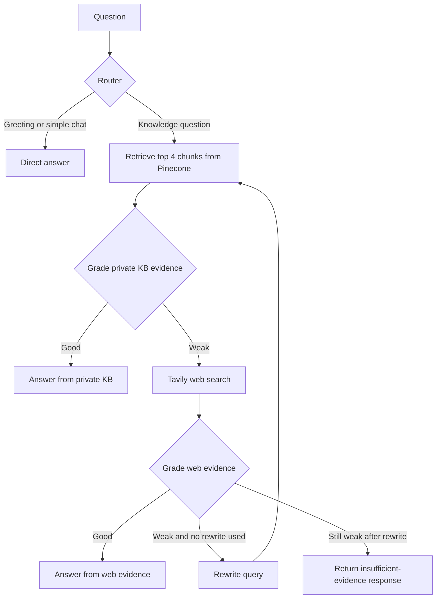

# Agentic RAG Workflow

A Jupyter notebook demonstrating an agentic retrieval-augmented generation (RAG) workflow. It answers from a Pinecone knowledge base first, grades the retrieved evidence, and uses Tavily web search as a fallback. LangGraph connects the routing, retrieval, grading, retry, and answer-generation steps.

## What the workflow does

The notebook loads the [LangGraph Agentic RAG guide](https://docs.langchain.com/oss/python/langgraph/agentic-rag), indexes it, and answers questions through this flow:



The web search returns up to five results. A weak web result triggers one query rewrite and a second pass through retrieval and web search. The final state reports the answer and its `source_used` value: `direct`, `private_kb`, `web_search`, or `insufficient_evidence`.

## Requirements

- Python **3.13**. The pinned `langchain-pinecone==0.2.13` dependency is not compatible with Python 3.14.
- API keys for Groq, Tavily, and Pinecone.
- Internet access for fetching the source page, downloading the embedding model on first use, and calling the hosted APIs.
- A Pinecone account that can create a serverless index in AWS `us-east-1`.

## Setup

Run commands from the project directory (the directory containing `workflow.ipynb`).

### macOS / Linux

```bash
python3.13 -m venv .venv
source .venv/bin/activate
python -m pip install --upgrade pip
python -m pip install -r requirements.txt
cp .env.example .env
```

### Windows PowerShell

```powershell
py -3.13 -m venv .venv
.\.venv\Scripts\Activate.ps1
python -m pip install --upgrade pip
python -m pip install -r requirements.txt
Copy-Item .env.example .env
```

Edit `.env` and replace the example values with your own keys:

```dotenv
GROQ_API_KEY=your_groq_api_key
TAVILY_API_KEY=your_tavily_api_key
PINECONE_API_KEY=your_pinecone_api_key
```

The notebook loads `.env` from the current project directory and stops with a clear error if a key is missing or still has its example value. Keep `.env` private: it is excluded by `.gitignore`. Do not paste real keys into notebook cells or commit them.

## Open and run the notebook

1. Open the project folder in VS Code.
2. Open `workflow.ipynb`.
3. Use **Select Kernel** and choose the Python interpreter in this project's `.venv`:
   - macOS/Linux: `.venv/bin/python`
   - Windows: `.venv\Scripts\python.exe`
4. Run cells from top to bottom.

The first cells load keys, fetch the source page, and split it into chunks of 1,000 characters with 150-character overlap. The embedding step downloads `sentence-transformers/all-MiniLM-L6-v2` on first use. Pinecone index creation and document ingestion happen before the agent graph is built.

The notebook includes three example questions. Each example calls the hosted model and may use web search, so run only the examples you need. You can also edit an example or add a new code cell:

```python
result = ask_agent("How does the workflow handle irrelevant retrieved documents?")
result["answer"]
result["source_used"]
```

`ask_agent` also prints the question, source path, and final answer, and returns the complete LangGraph state.

## Knowledge base and Pinecone

The current notebook configuration is:

| Setting | Value |
|---|---|
| Source page | `https://docs.langchain.com/oss/python/langgraph/agentic-rag` |
| Embedding model | `sentence-transformers/all-MiniLM-L6-v2` |
| Pinecone index | `industry-agentic-rag-kb` |
| Namespace | `langgraph-agentic-rag` |
| Similarity metric | Cosine |
| Pinecone region | AWS `us-east-1` |
| Retrieval count | 4 chunks |

The notebook creates the index if it does not exist and waits for it to become ready. Chunk IDs are deterministic, so re-running ingestion upserts unchanged chunks instead of creating duplicates. If you change the source or index settings, update the corresponding notebook configuration and use an appropriate namespace or index for the new collection.

## Project files

```text
workflow-rag/
├── .env                 # Your local API keys; do not commit
├── .env.example         # Required key names and setup template
├── .gitignore           # Excludes secrets and virtual environments
├── requirements.txt     # Python dependencies
└── workflow.ipynb       # Ingestion, LangGraph workflow, and examples
```

## Troubleshooting

- **`Import ... could not be resolved`**: Make sure VS Code and the notebook both use this project's `.venv`, then run `python -m pip install -r requirements.txt` in that environment. Restart the notebook kernel after installing packages.
- **Pinecone dependency cannot install on Python 3.14**: Create the environment with Python 3.13 as shown above, then install the requirements again.
- **`.env` not found**: Open the notebook with the project directory as the working directory. Confirm `.env` exists beside `workflow.ipynb`; create it by copying `.env.example`.
- **Missing API key**: Check that the key names in `.env` are exactly `GROQ_API_KEY`, `TAVILY_API_KEY`, and `PINECONE_API_KEY`, and replace all example values.
- **Pinecone index or dimension error**: Confirm the index is named `industry-agentic-rag-kb`, uses cosine similarity and the notebook's embedding dimension, and is accessible with the configured Pinecone account and region.
- **No relevant knowledge-base results**: The configured source is only the LangGraph guide. Check the retrieval preview, source URL, and namespace; unrelated questions may correctly be answered using web search instead.
- **Model or web-search error**: Check the corresponding API key, account access, network connection, and provider availability. The Groq model configured in the notebook is `openai/gpt-oss-20b`.

## Costs and privacy

The notebook sends prompts and retrieved/web evidence to Groq and search requests to Tavily. Pinecone stores the embedded source chunks, and the embedding model is downloaded from Hugging Face when needed. Provider usage limits, billing, and data-handling terms apply. Do not index or submit sensitive material unless you have approval to use these services.
